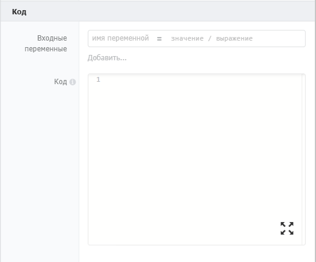

Компонент **Код (JavaScript)** выполняет JavaScript-код на сервере в изолированной среде -- песочнице. Используйте его для сложных вычислений, обработки данных и вызова поддерживаемых библиотек.

"){width=1440px height=816px}

## Настройка компонента

### Общие свойства

В поле **Название** укажите назначение компонента, а в поле **Описание** добавьте пояснение для коллег.

### Входные переменные

Код получает только явно переданные входные переменные. Для каждой переменной задайте имя и значение -- константу или выражение. Переданные объекты и массивы копируются в песочницу; изменения не затрагивают исходные данные процесса.

### Код

{width=529px height=439px}

Укажите JavaScript-код. Результат передайте командой `return`:

```javascript
const total = price * 2;
return total;
```

### Результат

{width=522px height=102px}

В поле **Сохранить в** укажите переменную процесса для записи результата `return`. Можно указать ключ объекта.

Компонент выполняется не более **5 секунд**. При превышении лимита срабатывает событие **Таймаут**. Асинхронные функции `setInterval`, `setTimeout` и `setImmediate` недоступны. Методы адаптера `crypto` выполняются синхронно.

Для простых вычислений используйте [выражения](./../../scripts-2/expression.md). Правила песочницы, передачи типов и библиотек для выражений и компонента одинаковы.

## 1\. Поддерживаемые типы на входе и выходе

| Тип | Поведение |
|---|---|
| Строки (`string`) | Сохраняются, включая Unicode и многострочный текст. Текст не является отдельным типом данных. |
| Числа (`number`) | Сохраняются, включая `NaN`, `Infinity` и `-Infinity`. |
| Логические значения (`boolean`) | Сохраняются значения `true` и `false`. |
| `null`, `undefined` | Сохраняются. |
| `bigint` | Сохраняется как `bigint`. |
| Обычные объекты и массивы | Передаются рекурсивно. Сохраняются циклы и повторные ссылки на объекты. Для обычных объектов переносятся собственные перечисляемые свойства со строковыми именами. |
| `Map`, `Set` | Сохраняется тип. Вложенные значения обрабатываются рекурсивно, включая ключи Map и элементы Set. |
| `Date` | Передаётся как Date, включая `Invalid Date`. |
| `RegExp` | Сохраняются выражение и флаги. Значение `lastIndex` не переносится. |
| `ArrayBuffer`, типизированные массивы, `DataView` | Передаются бинарные данные. Обычный `Uint8Array` не превращается в Buffer. |
| `Buffer` | На входе Node.js Buffer становится локальным Buffer внутри isolate. На выходе восстанавливается настоящий Node.js Buffer. Поддерживаются вложенные буферы. |
| Стандартные ошибки `Error`, `TypeError`, `RangeError` и другие | Передаются средствами сериализации V8. Сохранение пользовательских полей и собственного класса ошибки не гарантируется. |
| `SharedArrayBuffer` | Технически поддерживается механизмом передачи `isolated-vm`, но память остаётся общей между окружениями вместо создания независимой копии. |

Большинство поддерживаемых данных передаётся копированием. Buffer также переносится через копии байтов; общей памяти Buffer между хостом и isolate не возникает. Совместное хранилище разных представлений Buffer не сохраняется. `SharedArrayBuffer` является отдельным случаем с общей памятью.

Возвращённый Error является значением результата. Неперехваченный `throw` завершает вычисление ошибкой; это другой путь обработки.

## 2\. Преобразования и неподдерживаемые конструкции

| Значение или конструкция | Поведение на границе песочницы |
|---|---|
| Moment | На выходе преобразуется в Date, включая вложенные значения. Некорректный Moment становится `Invalid Date`. Методы Moment и сведения о выбранном смещении отдельно не переносятся. Преобразование входящего хостового Moment не предусмотрено. |
| Функция | На выходе преобразуется в текст через встроенный `Function.prototype.toString`. Замыкание и возможность вызова не передаются. На входе обычные функции не поддерживаются. |
| Экземпляр пользовательского класса | Передаются собственные перечисляемые данные. Прототип, методы прототипа и приватные поля не сохраняются. Собственные поля-функции на выходе становятся строками; на входе такие поля вызывают ошибку копирования. |
| Promise | Асинхронный `run()` ожидает Promise, возвращённый непосредственно скриптом. Синхронный `runSync()` его не поддерживает. Promise во вложенных полях автоматически не ожидаются и вызывают ошибку копирования. |
| `Symbol` как значение | Не передаётся и вызывает ошибку копирования. |
| Символьные и неперечисляемые свойства обычного объекта | Не переносятся общим обходом. |
| Getter, setter и дескрипторы свойств | Не сохраняются как поведение. Getter перечисляемого поля может выполниться; передаётся полученное значение. |
| `WeakMap`, `WeakSet`, Proxy | Не поддерживаются для передачи и вызывают ошибку копирования. |
| Генераторы и итераторы | Не передаются как продолжаемое вычисление. Перед возвратом нужно получить массив или другой поддерживаемый результат. |
| Произвольные объекты Node.js | Рабочий API потоков, сокетов, файловых дескрипторов и нативных объектов crypto через границу не переносится. Следует передавать поддерживаемые данные. Для криптографических операций предусмотрен отдельный адаптер. |

Преобразования вложенных значений распространяются на обычные объекты, массивы, ключи и значения Map, элементы Set. Они не означают обход произвольных внутренних полей всех встроенных типов.

Например, результат `{ date: moment(), fn: () => 42 }` передаётся как объект с полем `date` типа Date и полем `fn` со строкой исходного текста функции. Пользовательский `toString` функции при этом не вызывается. Для связанных и нативных функций полученный текст может содержать `[native code]` и не является восстанавливаемым исходником.

## 3\. Поддерживаемые библиотеки

**Библиотеки доступны через глобальные имена без import и require.** Один и тот же перечень действует для выражений и компонента «Код». Песочница подключает библиотеку, когда её глобальное имя встречается в тексте скрипта. Например, `_.sum([1, 2])` подключает lodash и возвращает `3`.

| Библиотека | Как обращаться | Назначение и особенности |
|---|---|---|
| Lodash | `_`, например `_.sum([1, 2])` | Операции над коллекциями, объектами, строками и другими данными. Исполняется внутри isolate. |
| Moment | `moment`, например `moment().format('YYYY-MM-DD')` | Создание, вычисление и форматирование дат. Возвращаемые экземпляры Moment преобразуются в Date по правилам раздела 2. |
| Полифил UTF-8 из `fast-text-encoding` | `new TextEncoder()`, `new TextDecoder()` | Преобразование строк и байтов UTF-8. Не поддерживает другие кодировки, `encodeInto()`, потоковый режим и `fatal: true`. |
| Браузерный Buffer из пакета `buffer` | `Buffer`, например `Buffer.from('Привет', 'utf8')` | Работа с байтами и кодировками внутри isolate. Передача на входе и выходе описана в разделе 1. |
| Адаптер crypto | `crypto`, например `crypto.createHash('sha256')` | Ограниченный набор криптографических операций хоста. Методы и ограничения перечислены в разделе 4. |

Поиск имени выполняется как поиск подстроки с учётом регистра: совпадение в комментарии или строке также подключает библиотеку. Динамическое построение имени не подключает отсутствующую библиотеку. Для `TextEncoder` и `TextDecoder` достаточно упомянуть одно из этих имён -- подключаются оба конструктора.

Buffer также подключается при наличии буферов в выбранных входных переменных, даже если слово `Buffer` отсутствует в скрипте. Crypto предоставляет локальный Buffer вместе со своим API; самостоятельный Buffer не подключает crypto.

**Состояние библиотек принадлежит одному вычислению.** При новом запуске создаются новые объекты библиотек. Их изменение внутри одного скрипта не влияет на следующие вычисления.

## 4\. Возможности и ограничения crypto

**Crypto предоставляет разрешённые операции через локальное API.** Пользовательский код работает с `crypto` внутри isolate, а хост выполняет криптографическую операцию и возвращает данные. Прямого доступа к модулю Node.js и его нативным объектам нет. Все предоставленные методы вызываются синхронно и не требуют `await`.

### 4\.1. Поддерживаемые методы

| Метод | Назначение и результат |
|---|---|
| `crypto.createHash(algorithm)` | Создаёт цепочку вычисления хеша. |
| `crypto.createHmac(algorithm, key, options)` | Создаёт цепочку HMAC -- хеша с секретным ключом. Из опций поддерживается только `encoding` для строкового ключа. |
| `hash.update(data, inputEncoding)` и `hmac.update(data, inputEncoding)` | Добавляют часть входных данных; возвращают ту же цепочку для следующих вызовов. |
| `hash.digest(encoding)` и `hmac.digest(encoding)` | Завершают вычисление. Без кодировки возвращают локальный Buffer, с кодировкой -- строку. |
| `crypto.createCipheriv(algorithm, key, iv)` | Создаёт цепочку шифрования AES с явными ключом и вектором инициализации IV. |
| `cipher.update(data, inputEncoding, outputEncoding)` | Шифрует очередную часть входных данных. Без выходной кодировки возвращает локальный Buffer, с `hex` -- строку. |
| `cipher.final(outputEncoding)` | Завершает шифрование и возвращает оставшиеся байты как Buffer либо строку `hex`. |
| `crypto.randomBytes(size)` | Возвращает Buffer случайных байтов. Размер -- целое число от 0 до 65536 включительно. |
| `crypto.randomUUID()` | Возвращает UUID как строку. |
| `crypto.timingSafeEqual(left, right)` | Сравнивает бинарные данные одинаковой длины и возвращает boolean. Строки не принимает; при разной длине возникает ошибка. |

Например, `crypto.createHash('sha256').update('abc').digest('hex')` возвращает хеш в виде строки из 64 шестнадцатеричных символов.

После `digest()` повторные `update()` и `digest()` запрещены. После `final()` повторные `update()` и `final()` запрещены. При возврате бинарного результата из песочницы локальный Buffer преобразуется в Node.js Buffer.

### 4\.2. Алгоритмы и форматы данных

**Для хешей и HMAC разрешён фиксированный перечень алгоритмов.** Поддерживаются `md5`, `sha1`, `sha224`, `sha256`, `sha384`, `sha512`, `sha512-224`, `sha512-256`, `ripemd160`. Имена алгоритмов приводятся к нижнему регистру. Фактическая доступность также зависит от OpenSSL и режима FIPS на сервере.

`update()` принимает строки, Buffer, ArrayBuffer и представления ArrayBuffer, включая типизированные массивы и DataView. У представления учитываются его смещение и длина. Кодировка строк по умолчанию -- UTF-8; можно явно указать кодировку, поддерживаемую локальным Buffer, например `hex` или `base64`. Для `digest()` также доступны кодировки локального Buffer.

**Для AES поддерживаются четыре режима с тремя размерами ключа.** Ключ и IV принимаются как строки или бинарные данные. Строки интерпретируются как UTF-8; если ключ задан hex-строкой, сначала нужно получить байты через `Buffer.from(keyHex, 'hex')`.

| Размер ключа | Поддерживаемые имена алгоритмов | Длина ключа | Длина IV |
|---|---|---|---|
| AES-128 | `aes-128-cbc`, `aes-128-ctr`, `aes-128-cfb`, `aes-128-ofb` | 16 байтов | 16 байтов |
| AES-192 | `aes-192-cbc`, `aes-192-ctr`, `aes-192-cfb`, `aes-192-ofb` | 24 байта | 16 байтов |
| AES-256 | `aes-256-cbc`, `aes-256-ctr`, `aes-256-cfb`, `aes-256-ofb` | 32 байта | 16 байтов |

В CBC включено дополнение PKCS#7; в CTR, CFB и OFB дополнение не требуется. Выход `cipher.update()` и `cipher.final()` поддерживает только Buffer без указания кодировки либо строку с кодировкой `hex`. Другие строковые выходные кодировки шифра не поддерживаются, даже если Buffer умеет их обрабатывать.

### 4\.3. Лимиты ресурсов

**Лимиты применяются к отдельным объектам и ко всему запуску.** МиБ и КиБ здесь означают соответственно 1024 × 1024 и 1024 байта. Счётчики crypto создаются заново для каждого вычисления песочницы.

| Ограничение | Предел |
|---|---|
| Суммарный ввод одной цепочки хеша или HMAC | 1 МиБ |
| Ключ HMAC | Отдельно 1 МиБ |
| Суммарный ввод одного шифра | 1 МиБ |
| Один бинарный входной аргумент операции хоста, включая аргумент сравнения | 1 МиБ |
| Один вызов `randomBytes()` | 64 КиБ |
| Вызовы `update()` одной цепочки хеша или HMAC | 1024 |
| Вызовы операций хоста за одно вычисление | 1024, включая неуспешные |
| Общий объём учитываемых байтов за одно вычисление | 16 МиБ |

Общий объём включает вход хешей/HMAC и шифров, ключи, IV, оба аргумента сравнения и генерируемые случайные байты. Хеш и HMAC вызывают операцию хоста при `digest()`; шифр -- при создании, каждом `update()` и `final()`. Поэтому лимит операций хоста не равен числу пользовательских вызовов `update()`.

Аргументы, расход байтов, число вызовов и срок доступности операций проверяются на хосте. Дополнительно действует таймаут песочницы. Уже начавшуюся нативную операцию хоста этот таймаут не прерывает.

### 4\.4. Неподдерживаемые возможности

**API ограничен перечисленными методами и их опциями.** В частности, не предоставляются:

- расшифрование: `createDecipheriv()` и другие методы decipher;
- другие шифры и режимы, включая AES-GCM, CCM, OCB, CFB1 и CFB8;
- дополнительные методы цепочек, например `hash.copy()`, `setAutoPadding()`, методы работы с AAD и тегами аутентификации;
- потоки и объекты `KeyObject`;
- подпись и проверка подписи, генерация ключей, PBKDF2 и scrypt;
- перечисление алгоритмов через `getHashes()` и `getCiphers()`, управление движками и FIPS через `setEngine()` и `setFips()`;
- callback-форма `randomBytes()`;
- опции `createHash()`, `createCipheriv()` и `randomUUID()`; у `createHmac()` разрешена только опция `encoding`.

Неизвестный метод отсутствует в API. Неподдерживаемый алгоритм, опция, формат аргумента или превышение лимита завершают соответствующий вызов ошибкой.
